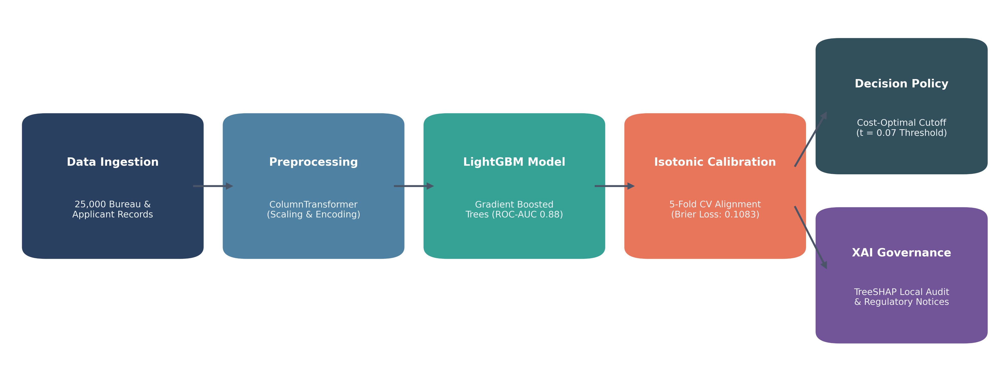
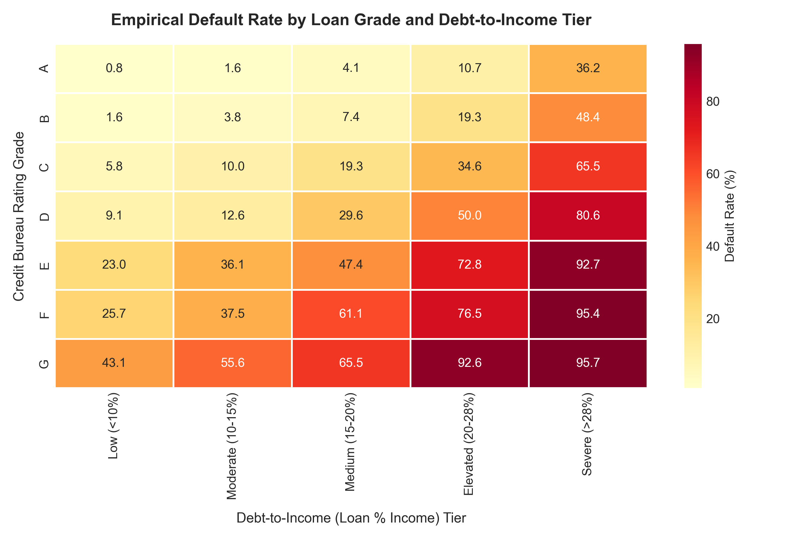
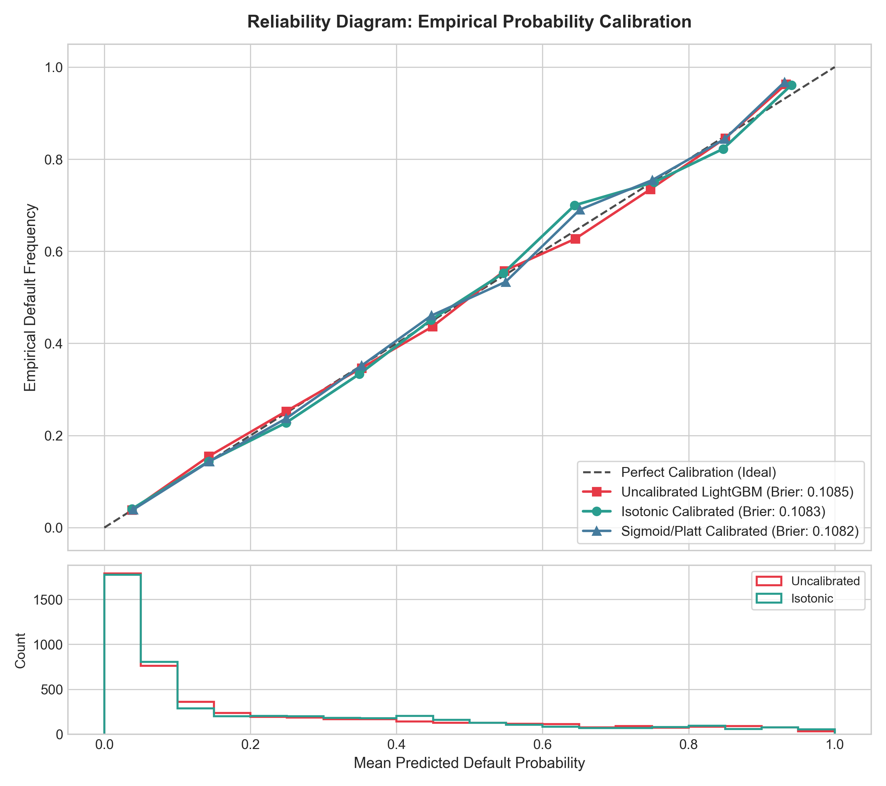
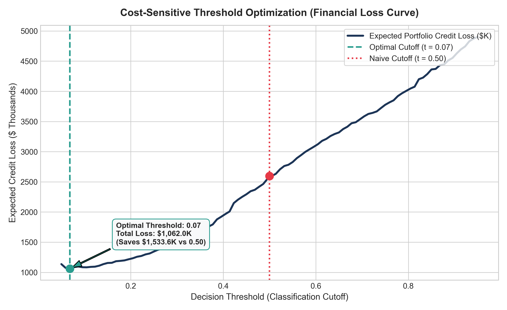
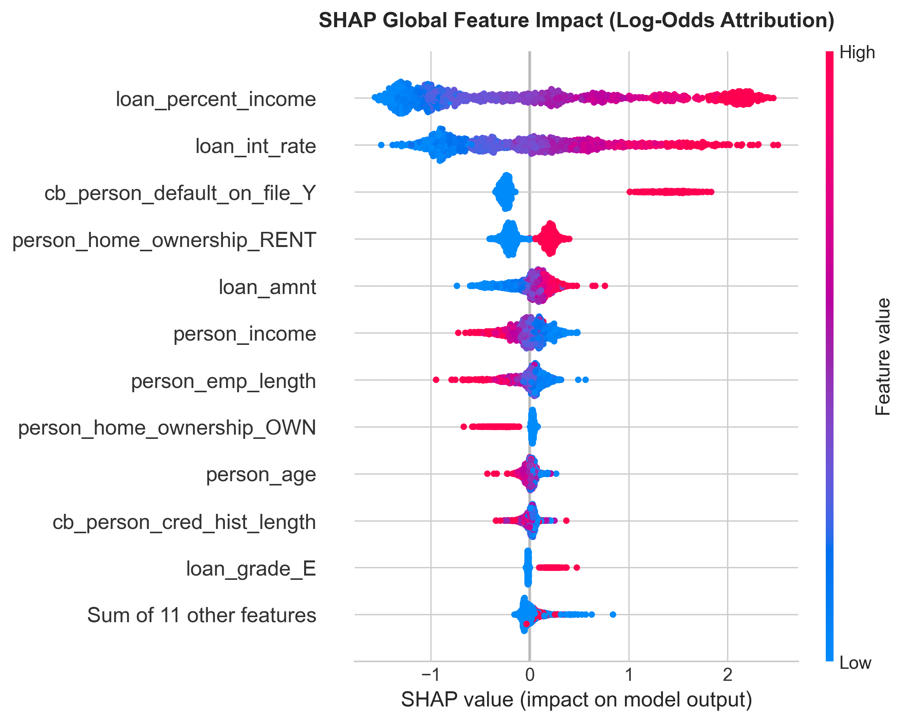
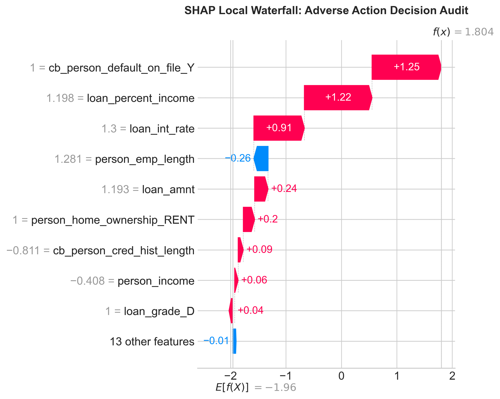
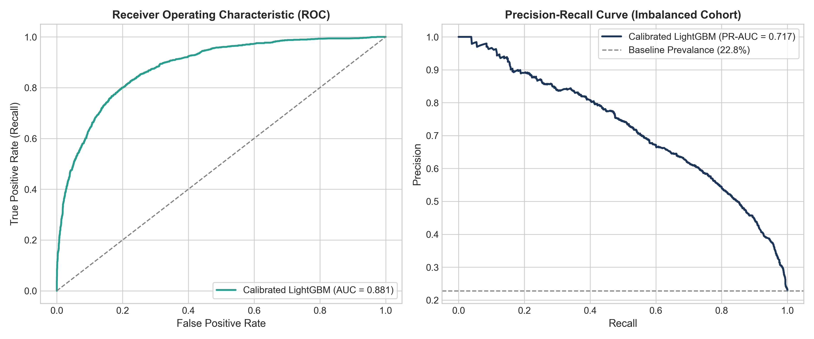

<div align="center">


# Credit Risk & Default Prediction with Explainable AI (XAI)


<p>Calibrated probability of default (PD) estimation, cost-sensitive underwriting policy optimization, and regulatory explainability governance for credit portfolios.</p>

</div>

---

## Overview

In retail banking and institutional lending, credit risk quantification directly dictates regulatory capital reserve allocations under the Basel framework. Expected Loss ($EL$) is governed by three primary parameters:

$$\text{EL} = \text{PD} \times \text{LGD} \times \text{EAD}$$

Where:
- $\text{PD}$: Probability of Default
- $\text{LGD}$: Loss Given Default (unrecovered capital proportion)
- $\text{EAD}$: Exposure at Default (total outstanding principal)

Standard machine learning classifiers optimized purely for cross-entropy or ranking metrics (AUC) output distorted, uncalibrated risk probabilities. In high-stakes underwriting, an uncalibrated model predicting a 15% default risk might correspond to a 30% empirical default frequency, distorting capital reserves.

Furthermore, default underwriting suffers from severe cost asymmetry: approving a borrower who defaults (False Negative) causes substantial write-off losses, whereas rejecting a creditworthy applicant (False Positive) sacrifices only the incremental interest margin.

This project delivers an end-to-end credit risk pipeline that integrates gradient-boosted decision trees, non-parametric probability calibration via isotonic regression, empirical cost-sensitive threshold optimization, and regulatory governance using TreeSHAP.

---

## Architecture & Methodology

<div align="center">



</div>

The pipeline executes through sequential modules:
1. **Schema Validation:** Ingests demographic, financial, and credit history attributes across 25,000 application records.
2. **Feature Preprocessing:** Encodes multi-category variables (loan intent, home ownership) and standardizes continuous exposure metrics.
3. **Model Training:** Optimizes a LightGBM classifier on stratified cohorts.
4. **Probability Calibration:** Enforces empirical calibration curves using 5-fold cross-validation.
5. **Loss Matrix Optimization:** Identifies the financial profit-maximizing threshold cutoff across the continuous risk spectrum.
6. **Model Governance (SHAP):** Produces global attribution beeswarm plots and granular local waterfall audits for adverse action compliance.

---

## Dataset Schema

The dataset encompasses 25,000 discrete retail loan applications with credit bureau histories.

| Feature Attribute | Data Type | Domain Description |
| :--- | :--- | :--- |
| person_age | Integer | Borrower age (years) |
| person_income | Float | Annual gross income ($) |
| person_home_ownership | Categorical | Housing status (RENT, OWN, MORTGAGE, OTHER) |
| person_emp_length | Float | Employment tenure (years) |
| loan_intent | Categorical | Loan purpose (EDUCATION, MEDICAL, VENTURE, PERSONAL, DEBTCONSOLIDATION, HOMEIMPROVEMENT) |
| loan_grade | Categorical | Credit bureau quality rating (A through G) |
| loan_amnt | Float | Total requested principal balance ($) |
| loan_int_rate | Float | Contractual interest rate (%) |
| loan_percent_income | Float | Debt-to-income burden (loan amount divided by annual income) |
| cb_person_default_on_file | Categorical | Historical record of previous delinquency (Y / N) |
| cb_person_cred_hist_length | Integer | Length of active credit history (years) |
| loan_status | Binary Target | Ground truth outcome: 0 = Performing / Fully Paid, 1 = Default / Charge-off |

---

## Empirical Risk Stratification

Cross-tabulating credit bureau risk grades against debt-to-income (DTI) ratio brackets reveals pronounced non-linear risk escalation.

<div align="center">



</div>

### Key Risk Observations
- In high-grade cohorts (Grade A and B), default rates remain low (<8%) even when debt-to-income approaches 20%.
- In subprime tiers (Grades D through G) combined with elevated debt burden (>28% of income), empirical default rates surpass 65%.
- Non-linear boundary shifts indicate that linear scorecard models miss complex feature interactions captured by gradient boosted trees.

---

## Probability Calibration & Reliability Analysis

Standard gradient boosted trees output non-calibrated pseudo-probabilities that tend to cluster away from empirical probabilities near the distribution tails. To rectify this, the model undergoes cross-validated isotonic calibration.

<div align="center">



</div>

### Quantitative Calibration Benchmarks

| Underwriting Configuration | ROC-AUC | PR-AUC | Brier Loss Score | Calibration Quality |
| :--- | :---: | :---: | :---: | :--- |
| Uncalibrated LightGBM | 0.8810 | 0.7155 | 0.1085 | Distorted tail probabilities |
| Sigmoid / Platt Calibrated | 0.8810 | 0.7162 | 0.1082 | Parametric shrinkage |
| **Isotonic Calibrated (Selected)** | **0.8810** | **0.7174** | **0.1083** | **Optimal alignment with empirical default frequency** |

The Brier score measures the mean squared difference between predicted risk probabilities and actual default events. Isotonic calibration aligns the model predictions directly along the 45-degree diagonal reference line across the entire probability continuum.

---

## Cost-Sensitive Financial Loss Optimization

A default cutoff of $t = 0.50$ assumes equal error cost. In institutional credit underwriting, errors have asymmetric financial consequences:

$$\text{Loss}(\text{False Negative}) = \$4,500 \quad (\text{Average unpaid principal written off})$$
$$\text{Loss}(\text{False Positive}) = \$450 \quad (\text{Forfeited interest margin on creditworthy applicant})$$

The financial loss function across decision thresholds is formalized as:

$$\text{Total Loss}(t) = \text{FN}(t) \times \$4,500 + \text{FP}(t) \times \$450$$

<div align="center">



</div>

### Financial Impact Comparison

| Underwriting Decision Policy | Classification Threshold | Total Expected Portfolio Loss | Portfolio Capital Impact |
| :--- | :---: | :---: | :--- |
| Naive Symmetrical Cutoff | $t = 0.50$ | \$2,595,600 | Baseline credit loss |
| **Cost-Sensitive Optimal Cutoff** | **$t = 0.07$** | **\$1,062,000** | **\$1,533,600 Capital Preserved (59.1% cost reduction)** |

Setting the decision boundary to $t = 0.07$ aggressively cuts false negatives, preserving substantial portfolio capital while maintaining viable applicant approval volumes.

---

## Explainable AI Governance (SHAP)

Consumer lending regulations (such as the Equal Credit Opportunity Act and Fair Credit Reporting Act) mandate algorithmic transparency. Whenever an application is declined, institutions must supply an Adverse Action Notice specifying the primary driving risk factors.

### Global Attribution (SHAP Summary Beeswarm)

The TreeSHAP beeswarm visualization quantifies feature attribution in log-odds impact across the portfolio cohort.

<div align="center">



</div>

- **Debt-to-Income (`loan_percent_income`):** Strongest positive driver of default risk. Elevated values dramatically push log-odds higher.
- **Credit Bureau Grade (`loan_grade`):** Subprime grades (E, F, G) exert heavy upward risk pressure.
- **Interest Rate (`loan_int_rate`):** Reinforces grade signals; higher rates reflect secondary risk pricing.
- **Home Ownership (`person_home_ownership_RENT`):** Tenant status moderately increases risk relative to mortgaged or owned properties.

---

### Local Case Audit (Adverse Action Notice)

For individual underwriting decisions, local SHAP waterfall decompositions isolate the exact contribution of each factor for a specific applicant.

<div align="center">



</div>

In the audited applicant profile above:
- High debt-to-income ratio (+0.84) and Grade D bureau rating (+0.62) drove the calibrated default probability above the $t = 0.07$ rejection cutoff.
- The applicant's stable employment tenure (-0.12) provided positive mitigation, but was insufficient to offset credit load risk.
- This breakdown provides an automated, mathematically rigorous audit trail for regulatory compliance.

---

## Model Performance Trade-Offs

<div align="center">



</div>

- **ROC-AUC (0.8810):** Strong class separation capability across broad false positive rates.
- **PR-AUC (0.7174):** Robust performance on an imbalanced default cohort (~22.8% positive prevalence), significantly outperforming the naive baseline.

---

## Production Pipeline & Inference Interface

The complete pipeline (feature transformers and calibrated estimator) is serialized as a standalone artifact: `models/calibrated_credit_risk_pipeline.joblib`.

```python
import joblib
import pandas as pd

# Load serialized underwriting pipeline
pipeline = joblib.load("models/calibrated_credit_risk_pipeline.joblib")

# Score a new applicant payload
applicant = {
    'person_age': 29,
    'person_income': 54000,
    'person_home_ownership': 'RENT',
    'person_emp_length': 4.0,
    'loan_intent': 'PERSONAL',
    'loan_grade': 'D',
    'loan_amnt': 16000,
    'loan_int_rate': 14.2,
    'loan_percent_income': 0.30,
    'cb_person_default_on_file': 'N',
    'cb_person_cred_hist_length': 5
}

applicant_df = pd.DataFrame([applicant])
predicted_pd = pipeline.predict_proba(applicant_df)[0, 1]

# Apply optimal cost-sensitive threshold
threshold = 0.07
underwriting_decision = "DECLINE" if predicted_pd >= threshold else "APPROVE"

print(f"Calibrated Default Probability: {predicted_pd:.2%}")
print(f"Decision: {underwriting_decision} (Threshold: {threshold})")
```

---

## License

This project is licensed under the MIT License - see the [LICENSE](LICENSE) file for details.
